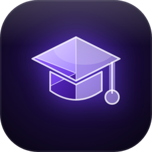
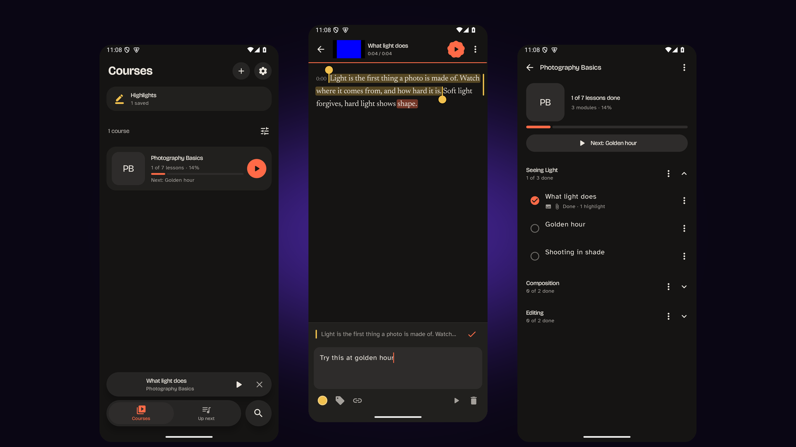
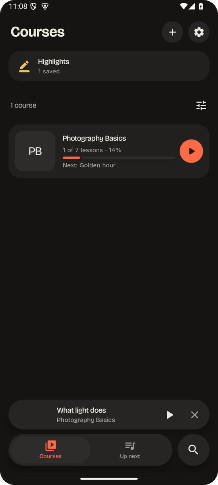
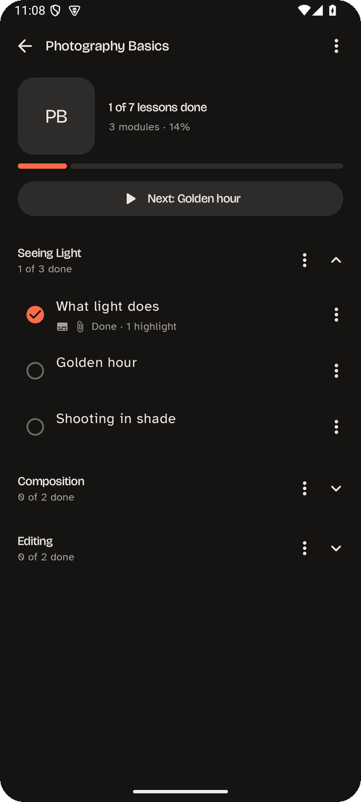
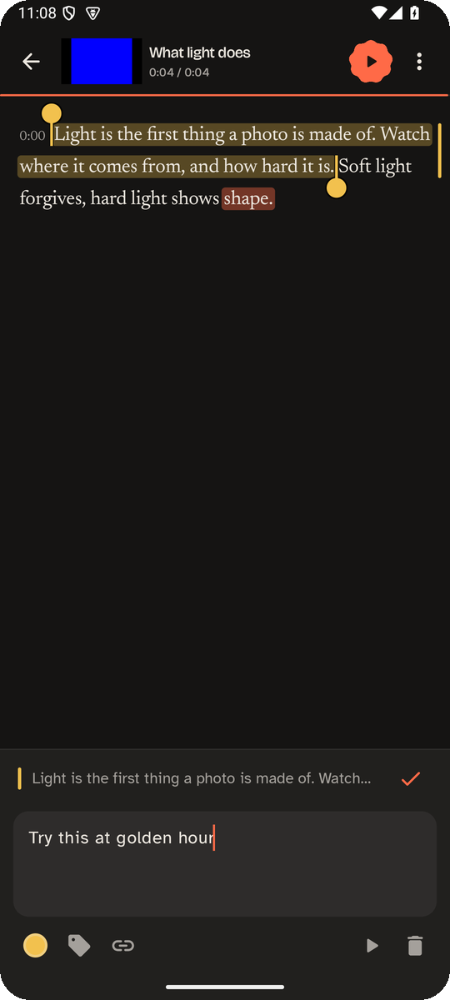
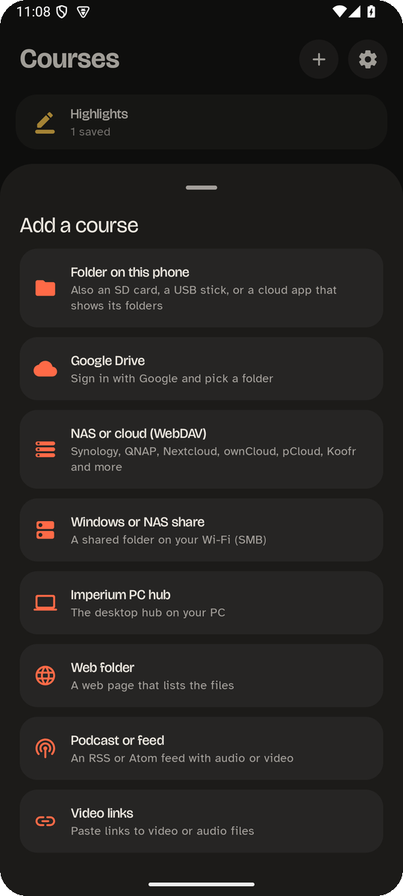
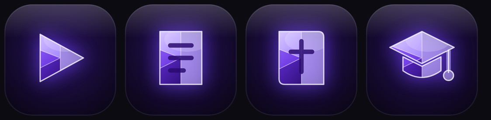

<p align="center">
  <a href="../../releases/latest"></a>
  
  
  <a href="LICENSE"></a>
</p>

<p align="center"></p>

<h1 align="center">ObsiLearn</h1>

<p align="center">
  <b>Your video courses, from wherever they are. What you learn, in Obsidian.</b><br>
  Point ObsiLearn at a folder, a NAS, Google Drive or a feed. It finds the modules and lessons, keeps your place, and lets you highlight what the teacher says.
</p>

<p align="center">
  <a href="../../releases/latest"><b>Download the latest APK</b></a>
</p>

<p align="center"></p>

---

## A closer look

<table>
  <tr>
    <td width="50%"></td>
    <td width="50%"></td>
  </tr>
  <tr>
    <td width="50%"></td>
    <td width="50%"></td>
  </tr>
</table>

## How it works

1. **Add a course.** Tap **+** and pick where it is.
2. **Watch.** ObsiLearn finds the modules and lessons from the folders and the file numbers. It opens each lesson where you stopped.
3. **Highlight.** The transcript follows the video, word by word. Hold a word and drag to mark it. Add a note.
4. **Keep it.** One tap saves your highlights as a note in your Obsidian vault, with links back to the exact second.

## Where your courses can be

| | |
|---|---|
| **A folder on this phone** | Also an SD card, a USB stick, or any cloud app that shows its folders in the file picker. |
| **Google Drive** | Sign in with Google and pick a folder. |
| **NAS or cloud (WebDAV)** | Synology, QNAP, Nextcloud, ownCloud, pCloud, Koofr and more. Turn WebDAV on in your NAS first. |
| **Windows or NAS share (SMB)** | A shared folder on your Wi-Fi, like `smb://192.168.1.20/Courses`. |
| **Imperium PC hub** | The desktop hub on your PC. |
| **Web folder** | A web page that lists the files. |
| **Podcast or feed** | An RSS or Atom feed with audio or video. |
| **Video links** | Paste links to video or audio files. |

Any layout works: one folder of videos, a folder for each module, or a folder of many courses. Files that share a number (`03. Intro.mp4`, `03. Intro.pdf`) are one lesson. A subtitle file with the video's name is its transcript.

## Features

### Watch

| | |
|---|---|
| **Pick up where you left off** | Every course shows how far you are and what comes next. |
| **Offline** | Save a lesson, a module or a whole course on the phone: the full video, or the sound only. Sound only is much smaller. |
| **Listen with the screen off** | Lessons keep playing in the background and on the lock screen. |
| **Speed** | Play faster or slower, from the player. |
| **Files with the lesson** | PDFs, slides and pages that sit next to a lesson open from that lesson. |

### Transcripts

| | |
|---|---|
| **From subtitle files** | `.srt` and `.vtt` files next to a video are read as its transcript. |
| **Make one** | For a lesson, a module or a whole course that has none. |
| **On the phone** | Free and offline. The speech model is fetched once. English, Spanish, French, German, Portuguese, Italian and Dutch. |
| **With your own key** | Faster and more exact. Works with OpenAI, Groq, or your own server. |
| **Word by word** | The word being said is marked as the video plays. |

### Obsidian

| | |
|---|---|
| **Your templates** | The same templates and vault setup as the other Obsi apps. |
| **Links to the second** | Each highlight links back to its exact moment in the lesson. |
| **One note per course** | Your progress lives in your vault, so it syncs with everything else. Nothing more is written. |
| **Both ways** | Tick a lesson in Obsidian, and ObsiLearn sees it. |
| **See every note** | Settings, then **Vault notes**, shows each note ObsiLearn wrote, and how many. |

A course note looks like this. Write your own notes under the last line, and ObsiLearn keeps them.

```markdown
---
type: obsilearn-progress
course: "Photography Basics"
lessons: 7
done: 1
progress: 14
tags:
  - obsilearn/progress
---

# Photography Basics

**1 of 7 lessons done** (14%)

## Seeing Light

- [x] [What light does](obsilearn://lesson/4be92e72f3ef468f) · 1 highlight
- [ ] [Golden hour](obsilearn://lesson/6bad8283db68f3ec)
- [ ] [Shooting in shade](obsilearn://lesson/5e0dc5acaf9a605c)
```

To keep these notes out of your searches: in Obsidian search, add `-tag:#obsilearn`. In Bases, filter on `type` is not `obsilearn-progress`. Or turn on **Keep out of search** in ObsiLearn, which adds the folder to Obsidian's Excluded files.

## Part of the Obsi apps

<p></p>

ObsiLearn is one of four apps that share one core, [obsi-core](https://github.com/Virus7976/obsi-core): ObsiTube for YouTube, [ObsiRead](https://github.com/Virus7976/obsiread) for the web, and [Obsi Bible](https://github.com/Virus7976/obsi-bible). They have the same Obsidian setup, the same highlights, one review of old highlights, and links that open in the right app.

## Coming next

- Highlight inside a lesson's PDF or slides.

## Install

1. Download the newest `ObsiLearn-v*.apk` from [Releases](../../releases/latest).
2. Open it on your phone. Allow installs from your browser or file app if Android asks.
3. Later updates show inside the app, in Settings, then **Updates**.

## Privacy

Your courses stay where they are. ObsiLearn reads them from there, and only writes to your phone and your vault. There are no ads and no tracking. A transcript made with your own key sends the lesson's sound to the service you chose, and nothing else.

## Build

Needs JDK 21. The shared core is the `core/` submodule. On a PC with `../obsi-core` next to this folder, that copy is used instead.

```bash
git clone --recursive https://github.com/Virus7976/Obsi-Learn.git
cd Obsi-Learn
./gradlew :app:assembleDebug
```

Releases are built by GitHub when a `v*` tag is pushed. See `.github/workflows/release.yml`.
